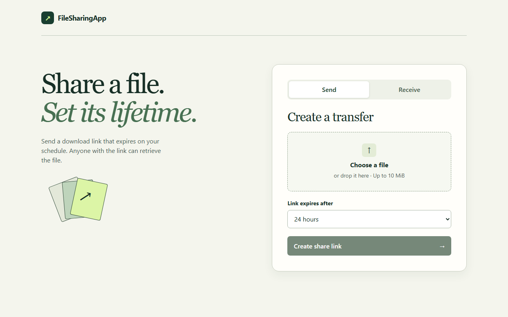

# FileSharingApp

Share a file with a time-limited recipient link. Senders can choose a lifetime of 1, 6, or 24 hours and revoke access from the sending tab. Recipients can open the link or paste the original transfer UUID. The maximum file size is 10 MiB.

Built with React, FastAPI and SQLite on a persistent local volume. The [system design](docs/design.md) covers the original architecture, transaction boundaries, failure handling, measured performance, and a multi-node design.



## Run locally

Run the following command from the repository root with the Docker engine running.

```sh
docker compose up --build
```

Open [FileSharingApp on localhost](http://localhost:8080). Compose exposes the web service on loopback and persists the database in the `uploads` named volume. `docker compose down` stops the services and keeps the data.

For native development, use Python 3.11+ and Node 22.12+ with npm. Create a Python virtual environment and activate it. Start the API from the repository root in the first terminal.

```sh
python -m pip install -r backend/requirements-test.txt
python -m uvicorn main:app --app-dir backend/app --port 8000 --no-access-log
```

Start Vite in a second terminal.

```sh
cd frontend
npm ci
npm run dev
```

Open the local URL printed by Vite. It proxies API requests to port 8000. Native development stores data in `backend/uploads`. Set `UPLOAD_DIR` to select a different local directory.

## Try the sender and recipient flow

1. Choose a file, select its lifetime, and create a share link.
2. Copy the link and open it in a separate browser window. Inspect the filename, size, and expiry, then download it.
3. Return to the sending tab and revoke the link. Reload the recipient page to see access denied. A transfer already downloading can finish.
4. The sending tab retains the most recent revoke control through a refresh when session storage is available. Starting a new transfer replaces that control. Existing links continue until their expiry or revocation.

## API

| Method | Route | Contract |
| --- | --- | --- |
| POST | `/api/v1/upload?ttl_hours=24` | Multipart field `file`. Returns `file_uuid`, filename, size in bytes, SHA-256, Unix expiry in seconds, and private `owner_token`. |
| GET | `/api/v1/shares/{uuid}` | Recipient metadata. |
| GET | `/api/v1/download/{uuid}` | Attachment with the stored filename. Supports a single byte range. |
| DELETE | `/api/v1/shares/{uuid}` | Supply `Authorization: Bearer <owner_token>`. Successful revocation returns 204. |
| GET | `/status`, `/ready` | Process liveness and database readability, respectively. |

For retryable uploads, generate a fresh random sender token for each logical transfer and send it in the Authorization header on the **first attempt and every retry**. The browser generates 32 random bytes and encodes them in hex. Reuse the same filename, content and TTL. Older callers can omit the header and use the token returned in the receipt. Share only the recipient URL.

## Verify

Run the backend checks from the repository root. For PowerShell, use the following commands.

```powershell
$env:PYTHONPATH = "backend/app"
python -m unittest discover -s backend/tests -v
```

In a POSIX shell, set the import path for the test command.

```sh
PYTHONPATH=backend/app python -m unittest discover -s backend/tests -v
```

Run `npm run lint` and `npm run build` from `frontend`. GitHub Actions is configured to run the backend and frontend checks on pushes and pull requests. With the native API running and at least 1 MiB of quota available, run `python backend/benchmark.py` for the loopback benchmark.

## Kubernetes

The manifests target one backend pod on a ReadWriteOnce volume and a ClusterIP service named `app`. Build the two images with `docker compose build`, then load the resulting `filesharing-backend:local` and `filesharing-frontend:local` images into your development cluster, or substitute accessible registry tags in the deployments. Apply `backend/kubernetes/deployment.yaml` and `frontend/kubernetes/deployment.yaml`. For a local demo, run `kubectl port-forward svc/frontend-service 8080:80` and open the localhost URL above.

The optional ingress examples need an ingress controller, your routable DNS names and a matching certificate issuer. The sample issuer uses the Let's Encrypt staging service. Configure trusted proxy addresses for your cluster before relying on per-client rate limits. Instructions for migrating an existing volume and rolling back are in the design document.
