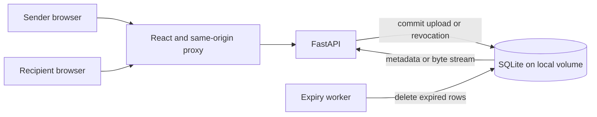

# File sharing service design

## What changed

At upstream commit `b0b3cee`, React posted a multipart file to FastAPI. The API read the whole file into memory, wrote it as `<uuid><extension>` on a volume, and returned the UUID. Every download listed the directory and picked the first prefix match. A miss fell through to a successful JSON null response. Upload cooldowns lived in a Python dictionary and disappeared on restart. An hourly sweep deleted files older than 24 hours, so a recipient could still retrieve an expired file before the next sweep.

The redesign keeps the public upload and download paths, the 10 MiB limit, and a 24-hour default. Its deployment target is the existing single backend with an attached disk. A recipient needs an exact share identifier. A sender can withdraw access. An interrupted or repeated upload has a defined outcome.

## The storage decision

The share row contains the bytes and the metadata. SQLite can publish them in a single transaction, stream a BLOB incrementally, and serve readers from a consistent snapshot in write-ahead logging mode. This avoids coordinating a filesystem rename with a separate metadata commit. Keeping payloads on the API host fits the current file limit and volume topology. The cost is one active database writer, a disk copy during upload, and a database read snapshot that may stay open as long as the client is downloading.

| Record | Access path | Purpose |
| --- | --- | --- |
| `shares` | Unique UUID, unique sender-token hash, expiry index | Payload, size, digest, display name, TTL, expiry, revocation |
| `rate_limits` | Client primary key, next-upload index | Persistent five-second upload cooldown |
| `storage_usage` | Single counter row | Charged payload bytes, updated by triggers in the same transaction as share changes |

A B-tree lookup replaces a linear directory scan. The quota check reads one counter. Revocation releases the charge immediately; expiry releases it on collection. The cap of 256 MiB applies to charged payload bytes. Filesystem planning must also allow for database pages, temporary uploads, and the write-ahead log. SQLite reuses freed pages. A successful upload does not imply a specific bound on physical disk usage.

## Upload and retry

1. The API limits the entire multipart body to 10 MiB plus 64 KiB of framing, including requests without a declared length. It accepts one file. The multipart parser spools large parts to local temporary storage.
2. A worker thread computes SHA-256 and enforces the exact file limit in 128 KiB chunks. It sanitizes the displayed filename. The filename never selects a storage path.
3. The writer obtains `BEGIN IMMEDIATE`. A matching sender-token hash identifies a retry. An active share with the same digest, filename and TTL returns its original receipt. Changed input returns 409. A retained expired or revoked share returns 410. These checks precede cooldown and quota admission.
4. For a new transfer the writer checks capacity and cooldown, reserves a BLOB of the known length, copies the bytes, and advances the client's cooldown. Commit makes all changes visible together. An exception rolls back the blob, its charge, and the cooldown.
5. The API returns the public UUID and the private sender token. If the response is lost after commit, replaying the same request with the same token retrieves the receipt. A client that lets the server generate the token cannot recover a lost receipt this way.

Retry identity lasts until collection at expiry. A revoked row retains its token hash through that window to prevent an old retry from reviving the link. A retry after collection can create a new transfer with a new UUID. SHA-256 supports integrity and retry comparison. Identical files from different transfers remain independent.

## Download, expiry and revocation

The UUID acts as a bearer capability for metadata and bytes. The sender token is a separate capability; the service persists its SHA-256 hash. The UI puts only the UUID in the recipient URL fragment. The API returns attachments, disables caching and supports single byte ranges for resuming a transfer. A multi-range request receives the full representation.

Every new read checks the exact UUID, expiry and revocation in its database snapshot. Missing, expired, and revoked shares all return 404. An authorized delete empties the BLOB and marks the row revoked in one transaction. A download admitted before that commit can finish from its snapshot. The service has no control over copies a recipient already downloaded.

Lifespan startup runs a sweep. A worker then collects expired rows and stale cooldowns every minute. Read-time expiry still works if cleanup is delayed. Database contention uses a five-second busy timeout. A storage operational error returns 503 with a retry interval. Capacity exhaustion returns 507; a cooldown returns 429 with the remaining wait.

## Capacity and operations

One 256 MiB quota can hold 25 full-size 10 MiB transfers, or 256 transfers averaging 1 MiB. As an illustrative workload, 100 uploads per hour at 1 MiB each retained for 24 hours require about 2.34 GiB of payload capacity before overhead. That workload exceeds this deployment's default budget. The 500 MiB example PVC must also accommodate SQLite and migration overhead. Slow readers can delay WAL checkpoint progress, and large simultaneous uploads compete for temporary disk space.

The liveness probe checks that the process can respond. Readiness executes a database read. Request logs include an opaque request ID, HTTP method, route template, status and elapsed time through response delivery. A matching `X-Request-ID` header helps correlate a user report. Monitor rates of 429, 503 and 507, latency by route, free disk, and WAL growth. The demonstration does not ship an alerting stack. Configure ingress logs to redact bearer IDs, terminate TLS and trust forwarded client addresses only from the intended proxy. The Compose backend is private to its network and its web proxy replaces the forwarded client address.

### Local measurement

A native Windows run used Python 3.12, one Uvicorn process, localhost HTTP, one previously uploaded 1 MiB file, four concurrent clients, one warm-up per route and 80 timed requests per route. Each full download was checked against its hash. Timing begins at the client and ends after receiving the body; rate includes client hash checking.

| Operation | Requests/s | p50 | p95 |
| --- | ---: | ---: | ---: |
| Metadata | 753.1 | 2.2 ms | 14.5 ms |
| Full 1 MiB download | 472.6 | 5.6 ms | 20.2 ms |

Run `python backend/benchmark.py` against the local API to repeat it. This measures warm reads of a single object. Upload contention, cold storage, TLS, WAN clients, mixed traffic and tail latency during collection require separate measurements before setting a production SLO.

## Upgrade and recovery

1. Stop writers to the old deployment. Snapshot the volume and confirm space for both the legacy files and the migrating database. Preserve the upstream image reference for rollback.
2. Start one new backend against the existing volume at `/app/uploads`. Startup recognizes regular legacy files named by the old UUID convention. It preserves the UUID and calculates expiry from the original file modification time plus 24 hours. Only the stored UUID filename and extension are recoverable.
3. The importer commits each active file before removing the legacy copy. An interrupted startup repeats the scan and skips an already imported UUID. Expired legacy files are discarded. Legacy links have no owner token and remain available until their original expiry.
4. Wait for `/ready`, then verify a known unexpired UUID before reopening traffic. `Recreate` avoids overlap with old writers during a rolling deployment. This strategy incurs downtime.
5. For rollback, stop the new backend, preserve its volume, then restore the pre-upgrade snapshot and upstream image. Shares created after the snapshot require a separate export or forward repair. For routine backups take a consistent SQLite backup or quiesce the service before snapshotting the volume.

## When to change the architecture

Sustained write contention, projected bytes beyond the volume budget, or a requirement to continue serving after node loss would justify a different deployment. A multi-node design would put immutable payloads in object storage, share metadata and uniqueness constraints in PostgreSQL, and enforce distributed admission with transactional quota reservations. An upload session would reserve quota, upload under a unique object key, verify length and checksum, then publish metadata. Abandoned sessions would expire; an idempotent reconciliation worker would release reservations and purge unreferenced objects.

For direct downloads, signed URLs reduce API bandwidth. An already issued URL can keep working until its own expiry. If immediate denial of newly initiated downloads is required, retain an authorization check at the serving edge or gateway. Validate that contract and measure the workload before choosing a URL lifetime.

## Verification

The backend suite exercises concurrent duplicate requests, conflicting replays, simultaneous quota admission, failure after the BLOB write, restart recovery, expiry at the exact boundary, authorized and unauthorized revocation, and a reader racing with revocation. It also covers legacy import, missing IDs, byte ranges, zero-byte files, the exact 10 MiB boundary, and chunked oversized requests.

A local Chrome smoke test used separate sender and recipient browser contexts. It verified upload, receipt recovery after refresh, recipient lookup, downloaded bytes and filename, a 375-pixel mobile layout, and denied access after revocation.
